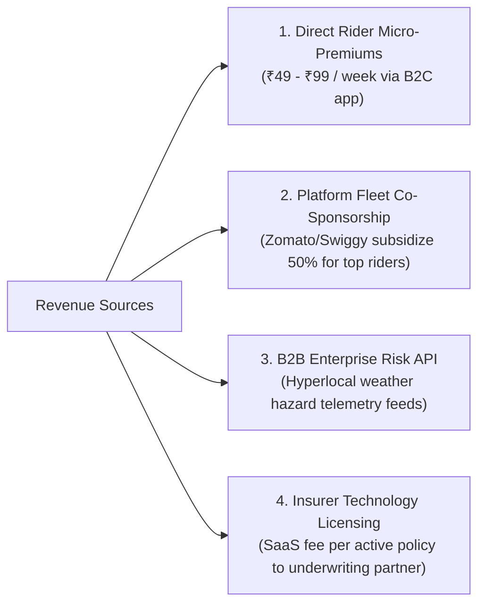

# VarshaRakshak — Business Model & Actuarial Unit Economics
**Sustainable Micro-Insurance Economics for the Indian Gig Economy**  
*Bajaj Technology Prototype • Judge Briefing Document 5*

---

> [!IMPORTANT]
> **REGULATORY & PROJECTION DISCLAIMER**  
> All financial projections, loss ratios, premium revenues, and cost breakdowns in this document represent **actuarial simulation models and unit-economic estimates** developed for technology demonstration. They do NOT represent audited corporate financial results or live underwriting commitments. Real-world insurance distribution in India requires partnership with an IRDAI-licensed general insurer (e.g., Bajaj Allianz General Insurance).

---

## 1. The Micro-Insurance Pricing Strategy

Traditional retail insurance forces delivery riders to pay hefty annual premiums (₹3,000–₹10,000 upfront) for indemnity products they rarely understand.

VarshaRakshak introduces a **7-Day Weekly Micro-Duration Pricing Architecture**:

```
┌─────────────────────────────────────────────────────────────────────────────────┐
│                     THE 3 STANDARDIZED WEEKLY SHIELD PLANS                      │
├─────────────────────┬───────────────────┬───────────────────┬───────────────────┤
│ PARAMETER           │ BASIC SHIELD      │ STANDARD SHIELD   │ PREMIUM SHIELD    │
├─────────────────────┼───────────────────┼───────────────────┼───────────────────┤
│ Weekly Premium      │ ₹49 / week        │ ₹69 / week        │ ₹99 / week        │
│ Daily Equivalent    │ ₹7.00 / day       │ ₹9.85 / day       │ ₹14.14 / day      │
│ Total Coverage Cap  │ ₹2,500 / week     │ ₹5,000 / week     │ ₹8,000 / week     │
│ Max Daily Payout    │ ₹800 / day        │ ₹1,500 / day      │ ₹2,500 / day      │
│ Waiting Period      │ 2 hours           │ 1 hour            │ 0 hours (Instant) │
│ Weather Triggers    │ Heavy Rain        │ Rain, Cloudburst, │ Rain, Cloudburst, │
│                     │ (≥35 mm/hr)       │ Heatwave, Coldwave│ Waterlogging (25cm│
│ Target Gig Persona  │ Part-time rider   │ Full-time rider   │ Heavy shift rider │
│                     │ (4-6 hrs/day)     │ (8-10 hrs/day)    │ (12+ hrs, EV/Bike)│
└─────────────────────┴───────────────────┴───────────────────┴───────────────────┘
```

### Why ₹49 to ₹99 per week works:
1. **Psychological Feasibility:** ₹49/week represents less than the earnings from a **single food delivery order** (average ₹45–₹60).
2. **Weekly Paycheck Alignment:** Gig platforms disburse rider earnings weekly (every Wednesday or Thursday). Deducting a ₹69 micro-premium from a ₹7,000 weekly payout is completely painless.
3. **Seasonal Opt-in/Opt-out:** Riders can activate coverage during the 4 monsoon months (June–September) and pause during dry winter months.

---

## 2. Actuarial Risk Modeling & Loss Ratio Sustainability

In insurance underwriting, sustainability hinges on maintaining a **Loss Ratio below 70%** (Claims Incurred divided by Net Earned Premium):

$$\text{Loss Ratio} = \frac{\text{Total Claims Paid}}{\text{Total Premiums Collected}} \le 70\%$$

### Micro-Climate Actuarial Assumptions (Mumbai Metro Case Study)
- **Monsoon Season:** 16 weeks (June 1 to September 30).
- **Severe Disruption Days:** Historical meteorological data indicates an average of **12 to 14 days** per monsoon season where hourly rainfall exceeds 35 mm/hr in a given urban PIN code.
- **Rider Pool:** 10,000 enrolled delivery partners.
- **Average Weekly Premium:** ₹65.00 (blended mix across ₹49, ₹69, and ₹99 plans).

### Unit Economics Simulation (10,000 Riders over 16-Week Monsoon)

```
Total Weekly Premium Inflow   = 10,000 riders × ₹62.50/week = ₹6,25,000 / week
Total Season Premium Inflow   = ₹6,25,000 × 16 weeks        = ₹1,00,00,000 (₹1.00 Crore)

Estimated Claim Frequency:
- An enrolled rider experiences an average of 1.2 triggering storm events per season.
- Total Triggered Claims      = 10,000 × 1.2 = 12,000 claims over 16 weeks.
- Average Parametric Payout   = ₹550 per triggered claim.
- Total Claims Payout Outflow = 12,000 × ₹550               = ₹66,00,000 (₹66 Lakhs)

ACTUARIAL LOSS RATIO          = ₹66,00,000 / ₹1,00,00,000   = 66.0% (EXCELLENT)
Gross Underwriting Margin     = ₹1,00,00,000 - ₹66,00,000   = ₹34,00,000 (34.0%)
```

---

## 3. Diversified Revenue Streams

VarshaRakshak is designed around a multi-sided business model:



1. **B2C Micro-Premiums:** Direct rider subscriptions paid via platform wallet deduction or UPI.
2. **Platform B2B Co-Sponsorship:** Delivery aggregators (e.g., Zomato Gold Fleet, Swiggy Super Partners) subsidize 50% of the weekly premium as an employee-retention benefit, reducing rider churn during bad weather.
3. **B2B Weather Risk Telemetry API:** Licensing anonymized, street-level waterlogging and road hazard intelligence to logistics fleets, quick-commerce dark stores, and municipal disaster authorities.
4. **Underwriting SaaS Technology Fee:** Earning a 12–15% technology enablement commission from the underwriting insurer (e.g., Bajaj Allianz) on all earned gross written premiums (GWP).

---

## 4. Operational Cost Structure & Breakeven Analysis

VarshaRakshak benefits from an ultra-lean operational cost base because **claims processing is 100% automated**:

| Cost Component | Monthly Cost (Est.) | Annual Scale Cost (100K Riders) | Strategic Advantage |
| :--- | :--- | :--- | :--- |
| **Cloud & Database (Supabase)** | ₹8,000 – ₹25,000 | ₹4,50,000 | Serverless PostgreSQL scales elastically |
| **Weather API Telemetry** | ₹15,000 – ₹40,000 | ₹8,00,000 | OpenWeatherMap + Open-Meteo cache |
| **Blockchain Gas (Sepolia / L2)** | ₹5,000 – ₹15,000 | ₹2,50,000 | Minimal batch hash anchoring on L2 |
| **SMS / Push Alert Infrastructure** | ₹12,000 – ₹30,000 | ₹6,00,000 | Hyperlocal localized notifications |
| **Customer Support & Operations** | ₹50,000 – ₹1,20,000| ₹18,00,000 | AI voice assistant resolves 80% of queries |
| **Total Operational Costs** | **~₹90,000 – ₹2,30,000** | **~₹39,00,000** | **Operating Expense Ratio: < 8%** |

*Compare this to traditional insurance where administrative and adjuster expenses exceed 25–35% of gross premiums.*

---

## 5. Go-to-Market & Scalability Roadmap

```
┌─────────────────────────────────────────────────────────────────────────────────┐
│                           GO-TO-MARKET MILESTONES                               │
├─────────────────────┬───────────────────┬───────────────────┬───────────────────┤
│ PHASE 1: PILOT      │ PHASE 2: PLATFORM │ PHASE 3: EXPANSION│ PHASE 4: PAN-INDIA│
│ (Months 1-3)        │ (Months 4-8)      │ (Months 9-18)     │ (Months 18-36)    │
├─────────────────────┼───────────────────┼───────────────────┼───────────────────┤
│ • 5,000 riders      │ • 50,000 riders   │ • 250,000 riders  │ • 1,000,000+      │
│ • Mumbai & Pune     │ • Direct Zomato / │ • Bengaluru, Delhi│ • All Tier 1 & 2  │
│   Monsoon hubs      │   Swiggy API      │   NCR, Chennai,   │   urban logistics │
│ • Regulatory sandbox│   integration     │   Hyderabad hubs  │   corridors       │
│ • Validate triggers │ • Co-sponsored fee│ • Heatwave trigger│ • E-commerce &    │
│   and fraud rules   │   split model     │   in North India  │   trucking lines  │
└─────────────────────┴───────────────────┴───────────────────┴───────────────────┘
```

### Customer Acquisition Strategy:
- **Zero Cold Acquisition Costs:** We do not acquire riders through expensive billboard ads. We integrate directly into the rider app’s earnings dashboard as an opt-in weekly toggle: *"Protect this week's earnings for ₹49"*.
- **Viral Referral Loops:** When a storm strikes and rider Sunil receives an instant ₹750 payout while sitting at a tea stall with fellow riders, word-of-mouth adoption spikes organically.

---

*Next Document:* [Innovation & Social Impact](file:///Users/pranav/🧑‍💻/v1/docs/judges/INNOVATION_AND_IMPACT.md)
