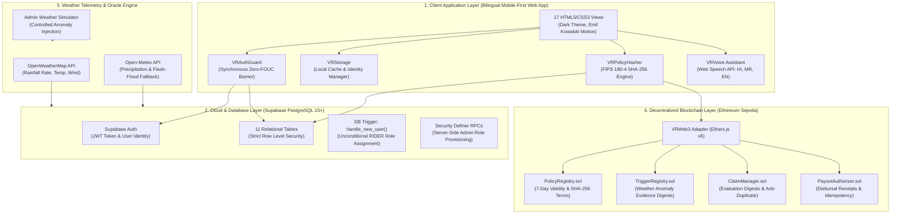
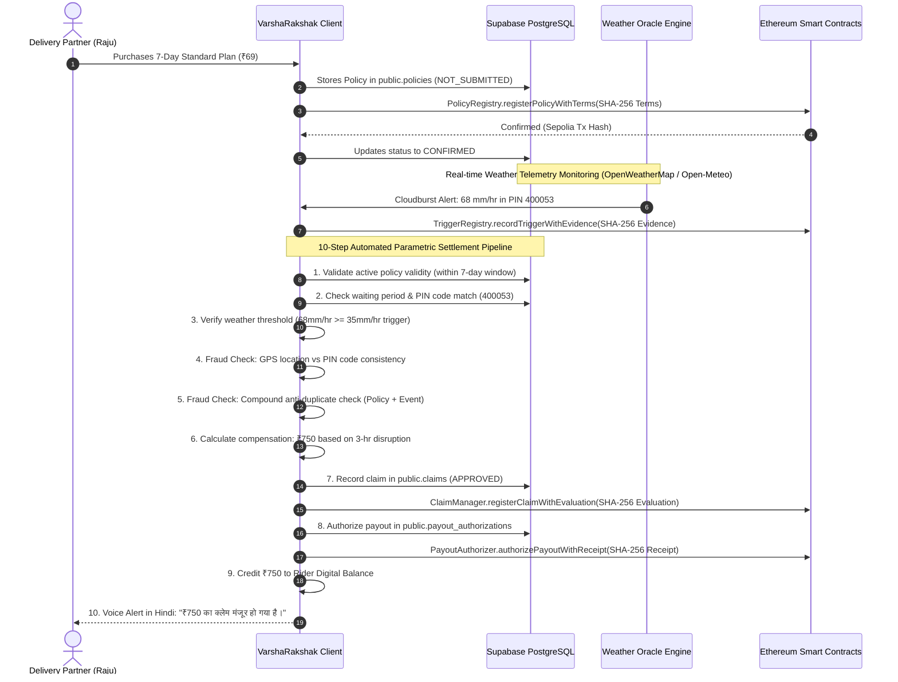

# VarshaRakshak — Technical Architecture & System Design
**Full-Stack Parametric Web3 Insurance Platform Specification**  
*Bajaj Technology Prototype • Judge Briefing Document 3*

---

## 1. High-Level System Architecture

VarshaRakshak is engineered as a **hybrid multi-tier architecture** that combines high-performance cloud databases, client-side cryptography, and decentralized blockchain verification:



---

## 2. On-Chain vs. Off-Chain Data Segregation (Privacy-by-Design)

A critical architectural achievement of VarshaRakshak is its **strict data privacy segregation**. Personal Identifiable Information (PII) is never broadcasted to the public Ethereum ledger:

```
┌─────────────────────────────────────────────────────────────────────────────────┐
│                    DATA SEGREGATION: OFF-CHAIN VS. ON-CHAIN                     │
├───────────────────────────────────────┬─────────────────────────────────────────┤
│ OFF-CHAIN (Supabase PostgreSQL + RLS) │ ON-CHAIN (Ethereum Sepolia Contracts)   │
├───────────────────────────────────────┼─────────────────────────────────────────┤
│ • Rider Full Legal Name & Phone       │ • Pseudonymous Hash: keccak256(riderId) │
│ • Complete Residential Street Address │ • 6-digit delivery PIN code only        │
│ • Vehicle Registration & Driving Lic. │ • Policy ID bytes32                     │
│ • Delivery Platform ID (e.g. ZOM-812) │ • 7-Day Start & Expiry Unix Timestamps  │
│ • Raw GPS Telemetry & Coordinates     │ • Max Coverage Limit & Premium (₹49-99) │
│ • Emergency Contact Details           │ • SHA-256 Digest of Canonical Terms     │
│ • Financial Bank Account / UPI Details│ • SHA-256 Digest of Weather Evidence    │
│ • Full Audit Logs & Operator Comments │ • SHA-256 Digest of Settlement Receipt  │
└───────────────────────────────────────┴─────────────────────────────────────────┘
```

### Why this matters to judges:
1. **GDPR / DPDP Act 2023 Compliance:** Indian and global data privacy regulations mandate the "Right to Erasure". Blockchains are immutable. By keeping PII in Supabase, a rider's personal data can be deleted upon request (`ON DELETE SET NULL`), while the financial audit hashes remain tamper-proof on-chain.
2. **Minimal Gas Footprint:** Storing strings like full names or raw telemetry on Ethereum incurs massive gas costs. Storing compact 32-byte SHA-256 digests reduces transaction gas by over 80%.

---

## 3. Cryptographic Hashing Architecture: SHA-256 vs. Keccak-256

VarshaRakshak implements a mathematically sound **dual-layer cryptographic strategy**:

```
                                  RIDER POLICY TERMS
                                          │
                   ┌──────────────────────┴──────────────────────┐
                   │                                             │
                   ▼                                             ▼
     Canonical String Normalization                 EVM Identifier Transformation
                   │                                             │
                   ▼                                             ▼
            FIPS 180-4 SHA-256                            Ethereum Keccak-256
                   │                                             │
                   ▼                                             ▼
        sha256_terms_hash (bytes32)                    policyId / riderHash (bytes32)
   "0x3089e3b8ff23db1b75fa599bc5943a41..."       "0x7a8b9c0d1e2f3a4b5c6d7e8f4b78a9c3..."
                   │                                             │
                   ▼                                             ▼
       DOCUMENT INTEGRITY ANCHOR                       SMART CONTRACT STORAGE KEY
```

1. **SHA-256 (FIPS 180-4 NIST Standard):**
   - Implemented via `VRPolicyHasher.js` using browser-native Web Cryptography API (`crypto.subtle.digest("SHA-256")`).
   - Normalizes JSON properties into a canonical, alphabetically-sorted string before hashing.
   - Exhibits full **avalanche effect**: changing a single digit in the premium or coverage limit flips ~50% of the output bits, making any post-issuance tampering immediately detectable.
2. **Keccak-256 (Ethereum Native):**
   - Used for Solidity mappings, event topics, compound unique keys (`keccak256(abi.encodePacked(policyId, eventHash))`), and pseudonymous user obfuscation.

---

## 4. End-to-End Parametric Evaluation & Settlement Lifecycle

The flowchart below traces the 10-step automated pipeline executed when severe weather strikes:



---

## 5. Security Architecture & Threat Mitigations

| Security Domain | Threat Vector | Technical Defense Implemented | Status |
| :--- | :--- | :--- | :--- |
| **Authentication** | Direct URL tampering to access `/admin.html` | `VRAuthGuard` synchronous pre-render barrier + server-side role check | `VERIFIED ON SUPABASE` |
| **Privilege Escalation** | User tampering with browser storage or signup metadata | Role strictly derived from `public.profiles`. Trigger unconditionally assigns `RIDER`. | `VERIFIED ON SUPABASE` |
| **Flash of Private Data** | Back-button navigation restoring cached dashboard (bfcache) | `pageshow` event listener verifies session on persisted restorations | `VERIFIED ON SUPABASE` |
| **Cross-Tenant Privacy** | Rider A attempting to read or modify Rider B's policies/claims | Supabase Row Level Security: `auth.uid() = rider_id` enforced on all tables | `VERIFIED ON SUPABASE` |
| **Oracle Spoofing** | Rider crafting fake weather reports to trigger fake claims | Direct rider INSERT disabled on `weather_events`. Only admin or service role can insert. | `VERIFIED ON SUPABASE` |
| **Contract Reentrancy** | Attacker draining balances via recursive payout requests | Idempotency guard: `keccak256(claimId, receiptHash)` prevents re-execution | `TESTED LOCALLY` |
| **Terms Tampering** | Insurer modifying policy coverage or premium post-issuance | Document SHA-256 hash anchored in `PolicyRegistry`; mismatches fail validation | `TESTED LOCALLY` |

---

*Next Document:* [Features & Step-by-Step Demo Guide](file:///Users/pranav/🧑‍💻/v1/docs/judges/FEATURES_AND_DEMO.md)
